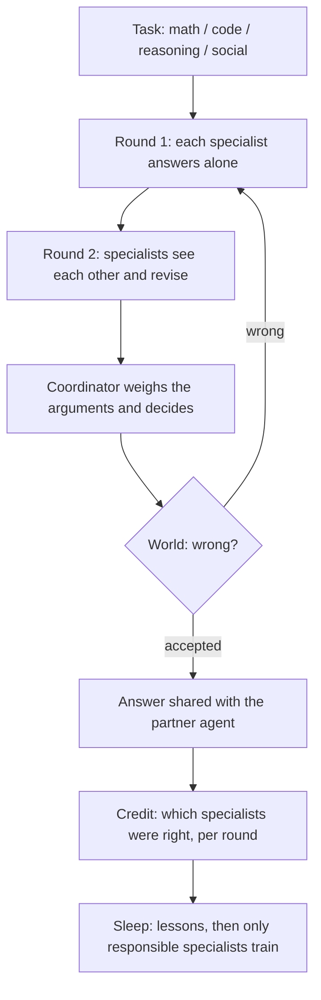

# CogArch

<p align="center">
  <a href="LICENSE.md"></a>
  <a href="https://www.python.org/downloads/"></a>
</p>

**Do the parts of a brain-like AI agent specialise when the world only ever says "wrong"? And do two such agents learn more together than one alone?**

Each agent has four specialists (logical, creative, skeptical, empathetic), an LLM coordinator, and a memory. They work on maths, code, reasoning and social problems. The environment never reveals a correct answer; it only says whether the agent's final answer was wrong. A correct answer becomes known only when an agent finds one the world accepts, and it is then shared with the partner agent.

---

## How it works



| Brain | CogArch |
|---|---|
| Specialised regions process in parallel | Four specialists with their own LoRA weights; personas are only the initial bias |
| Global workspace: specialists share a stage, content is broadcast | Discussion round: each specialist sees the others' answers and revises |
| Prefrontal cortex integrates | Coordinator LLM weighs the final positions and writes the answer |
| Regions compete; the one that wins an input learns from it (mixture of experts) | Only specialists that were right learn from a task; if nobody was, the domain's best performer ("owner") learns it |
| Dopamine prediction errors update values | Running record per specialist and domain: v ← v + α(outcome − v) |
| Hippocampus → cortex during sleep | Episodic memory, ExpeL-style lesson editing, then DPO + NLL fine-tuning |
| Learning from others | Accepted answers are shared between the two agents |

## Measurements

| What | How |
|---|---|
| **Benchmarks** (start and end) | HumanEval+, MBPP+ (EvalPlus), GSM8K, MATH-500, ARC-Challenge, SocialIQA, EmoBench (understanding and application) |
| Whole agent | Round 1 → discussion → decision, no memory |
| Each specialist alone | Own persona, no discussion: shows **specialisation** |
| Plain single models | No persona, greedy, standard prompts (EvalPlus protocol for code): base model at the start, every fine-tuned specialist at the end; comparable to published scores |
| During training | Per-domain validation for the whole agent and each specialist, domain records and owners, discussion effects (answers changed, wrong → right), learning from the partner, answer divergence between agents |

Training domains: code (MBPP minus MBPP+), maths (GSM8K train), reasoning (ARC-Challenge train), social (SocialIQA train). EmoBench and MATH-500 are evaluation-only.

## Experiment

| Config | Condition |
|---|---|
| `config/general.yaml` | Two agents teaching each other |
| `config/general_solo.yaml` | One agent alone (same system, no partner) |
| `cogarch baseline` | The untrained system, benchmarked once |

## Running on a GPU server

Tested target: 1× AMD MI300X (ROCm). vLLM and the experiment both run from AMD's vLLM image, in two containers.

```bash
scripts/setup_server.sh              # Docker, image, experiment container, datasets
MODEL=Qwen/Qwen2.5-1.5B-Instruct make serve
make dashboard && make tunnel        # live dashboard + public https link (Cloudflare)
make smoke                           # every component, then a tiny end-to-end run
make calibrate                       # untrained team per domain: solve rates, formats
make baseline                        # untrained benchmarks, once
scripts/launch_pilot.sh 4            # pair vs solo, 4 replicates each
```

On your laptop, keep a copy of everything while runs progress: `scripts/sync_to_laptop.sh root@<server>`.
When runs finish: `python -m cli.main analyze` writes `data/analysis/summary.md` and figures.

The dashboard drills down from runs → cycles → problems → attempts and shows every prompt
and reply (round 1, discussion, decision), the environment's verdict, which specialists were
right, specialisation by domain, lessons, and each part's training pairs and DPO statistics.

## Development

```bash
pip install -e ".[dev]"
make test lint        # unit tests + an offline end-to-end run of the whole pipeline
```

## Layout

```
src/
  config.py             typed config
  models/core.py        tasks, deliberation, rounds, preference pairs, reports
  tasks/                training curricula and benchmarks (code, maths, reasoning, social, emotion)
  environment.py        answer extraction and judging ("wrong" only)
  execution/            isolated sandbox for code
  inference/            vLLM client, prompts, Agent (round 1, discussion, decision)
  memory/               working / episodic / semantic stores
  training/
    community.py        rounds, sharing, credit assignment per round, memory
    preferences.py      competition: who learns what; domain records
    dpo_job.py, trainer.py, registry.py   DPO + NLL fine-tuning, adapter versions
  eval/scoring.py       agent / specialist / plain benchmark scoring
  experiment.py         (compete → sleep → validate) × cycles → final benchmarks
  calibration.py, smoke.py, analysis.py, dashboard.py
config/  prompts/  scripts/
```

## License

MIT — see [LICENSE.md](LICENSE.md). Built by [Arnav Gupta](https://github.com/info-arnav).
