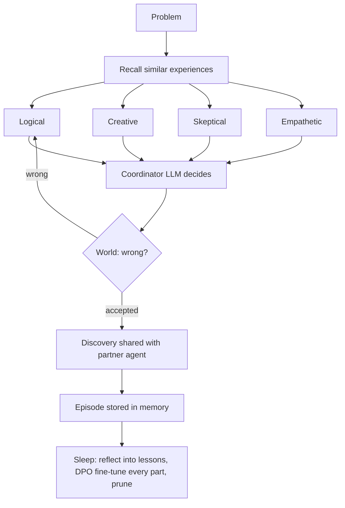

# CogArch

<p align="center">
  <a href="LICENSE.md"></a>
  <a href="https://www.python.org/downloads/"></a>
</p>

**Can two brain-like AI agents teach each other the right answers when the world only ever tells them "wrong"?**

Each agent is a small brain-inspired system: four specialists propose solutions, an LLM coordinator decides the agent's answer, and a memory keeps what it has lived through. The environment never reveals a correct answer. It only says whether the agent's answer was wrong. A right answer becomes known only when some agent finds one that the world accepts. That agent then shares it, and every part of both agents learns from it during a "sleep" phase.

---

## How it works



| Part | Brain analogy | Implementation |
|---|---|---|
| 4 specialists | Specialised regions | Same base model, different persona prompts, **each with its own LoRA adapter** |
| Coordinator | Prefrontal cortex | An LLM with its own adapter; reads all proposals and picks or combines them |
| Feedback | Learning from the world | Only "Your solution is wrong." Never tests, expected outputs or answers |
| Working / episodic / semantic memory | Short-term, hippocampus, cortex | Session buffer; embedded JSONL episodes; SQLite lessons |
| Sleep | Consolidation | LLM reflection into lessons, then DPO fine-tuning of every specialist and the coordinator |
| Two agents | Two people learning together | Different seeds, separate memories and weights; accepted solutions are shared |

**Credit assignment.** The world judges only the coordinator's answer, so specialists whose proposals weren't submitted don't learn from the world directly. Once a solution is known, the agent writes its own example calls and checks which of its proposals behave the same way as the known solution. That decides each part's DPO pairs:
- Specialist: the known solution is preferred over its own first proposal, when that proposal behaves differently.
- Coordinator: adopting a proposal that behaves like the known solution is preferred over adopting one that doesn't.

**Measurement.** Every run records validation Pass@1 after each cycle, HumanEval/HumanEval+ and MBPP+ (EvalPlus) at the start and end, how far the agents' answers diverge, which specialists the coordinator relies on, and where training pairs came from (the agent itself or its partner).

## Experiment

| Config | What it tests |
|---|---|
| `config/pilot.yaml` | Two agents teaching each other |
| `config/pilot_solo.yaml` | One agent learning alone (same system, no partner) |
| Baseline (start of every run) | The untrained model |

Training problems: MBPP, excluding every task in MBPP+, with 50 held out for validation and rollback. Evaluation: HumanEval, HumanEval+, MBPP+.

## Running on a GPU server

Tested target: 1× AMD MI300X (ROCm). vLLM and the experiment both run from AMD's vLLM image, in two containers.

```bash
scripts/setup_server.sh          # Docker, image, experiment container, datasets
make serve                       # vLLM with runtime LoRA loading on :8000
make smoke                       # checks every component, then a tiny end-to-end run
make pilot                       # 2 configs × 2 replicates, in the background
make dashboard                   # live dashboard on the server's localhost:8080
```

To view the dashboard from your machine: `ssh -L 8080:localhost:8080 root@<server>`, then open http://localhost:8080.

Results land in `data/runs/<run>/`. Each run directory has:
- `report.json`
- `rounds/cycle_N.jsonl`, with every proposal, decision and verdict
- `adapters/` and `memory/`

## Development

```bash
pip install -e ".[dev]"
make test lint
```

## Layout

```
src/
  config.py                 typed config
  models/code.py            problems, decisions, rounds, preference pairs, reports
  execution/                isolated sandbox, harness, feedback ("wrong" only)
  inference/                vLLM client, prompts, Agent (specialists + coordinator)
  memory/                   working / episodic / semantic stores
  training/
    community.py            rounds, sharing discoveries, credit assignment, memory
    preferences.py          DPO pairs per specialist and coordinator
    dpo_job.py, trainer.py  DPO fine-tuning jobs (TRL + PEFT), run in parallel
    registry.py             adapter versions and rollback
  eval/                     MBPP training pool, EvalPlus evaluation
  experiment.py             baseline → (compete → sleep → validate) × cycles → final eval
  smoke.py                  server checks
config/                     pilot, solo and smoke configs
prompts/                    specialist and coordinator personas
scripts/                    server setup, vLLM, pilot launcher
```

## License

MIT — see [LICENSE.md](LICENSE.md). Built by [Arnav Gupta](https://github.com/info-arnav).
